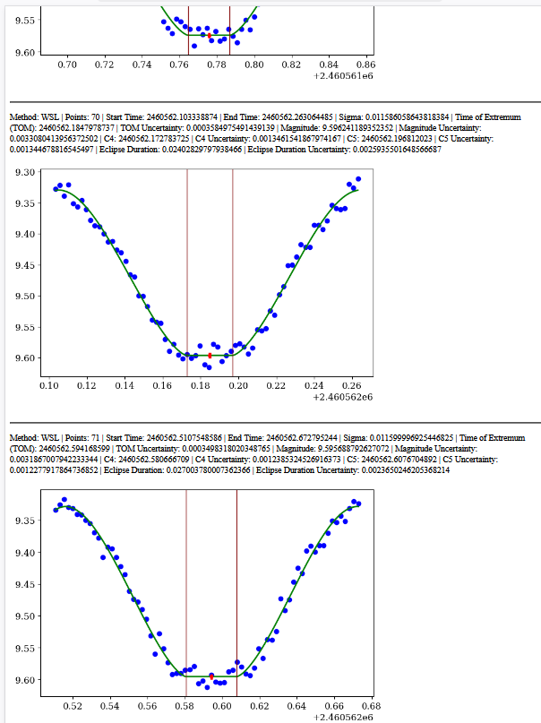

# lc_approx

Extended fork of [mpyat2/lc_approx](https://github.com/mpyat2/lc_approx). The approximation methods in `ila_code/ila.py` are the original ones. Licence: MIT. Copyright 2025 Maksym Yu. Pyatnytskyy.

## Install

The library needs NumPy and SciPy. Python 3.10 or newer.

```bash
pip install -e .
```

Distribution name `lc-approx`, version 0.1.0.

`original_demos/ila_ap.py` and `original_demos/split_lc.py` need the `cli` extra (pandas, matplotlib, colorama):

```bash
pip install -e ".[cli]"
```

## Import

```python
from ila_code.fit import fit_extremum
from ila_code.ila import approx, method_result, f_AP_a, f_WSAP_a, f_WSL_a, f_A_a
```

`fit_extremum(method, t_obs, y_obs, maxfev=100000)` fits one window and returns a `FitResult`. A failed window is a result. The next window still runs. `maxfev` defaults to 100000, the value `original_demos/ila_ap.py` passes. `approx` itself still defaults to 12000.

A filled `time` is the command-line time of extremum (`accepted`, `bounds_outside`, `short_core`, `sigma_missing`). An empty `time` is the golden `nan`: `method_result` did not return a finite time, and this function does not invent one. `sigma_time` is the formal covariance error. `residual_rms` is the residual scatter. `kind` is `maximum` or `minimum` of the array that was passed. Negative C2 is a maximum of that array.

`approx(method, t_obs, m_obs, maxfev=12000)` returns `(params_opt, params_cov, param_warning)`.

`method_result(method, params_opt, params_cov, t_min, t_max)` returns the seven-value time-of-extremum tuple. For AP and WSAP it wipes a vertex that lies outside `[C4, C5]`. `extremum_terms` is that same arithmetic before the wipe.

`f_AP_a`, `f_WSAP_a`, `f_WSL_a`, and `f_A_a` evaluate the fitted model and return lists.

Method ids: `AP`, `WSAP`, `WSL`, `A`. Small runnable series are in [examples/README.md](examples/README.md). The original command-line scripts, their launchers, and `test_data/` are in [original_demos/](original_demos/).

## Golden results

Stored CLI times of extremum, and the commands that reproduce them, are in [approx_output/golden/README.md](approx_output/golden/README.md).

## Tests

```bash
pip install -e ".[test]"
python -m pytest
```

`tests/test_golden_cli.py` re-runs the stored commands and compares the whole text file. `tests/test_fit_matches_golden.py` checks that `fit_extremum` returns those times. The files were captured with Python 3.10.12, NumPy 2.2.6 and SciPy 1.14.0. A different SciPy can change the last digits and fail the test. The stored files stay as they are.

-------------------------------------------------------------------------------

# Original project description

The text below is the original README from mpyat2/lc_approx, unchanged.

Python scripts to approximate light curves with different approximation methods.
See, for example:

Andrych, Kateryna D.; Andronov, Ivan L.; Chinarova, Lidia L.
MAVKA: Program of Statistically Optimal Determination of Phenomenological Parameters of Extrema. Parabolic Spline Algorithm And Analysis of Variability of The Semi-Regular Star Z UMa
Journal of Physical Studies, Vol. 24, No. 1, Article 1902 [10 pages] (2020)
Bibcode: 2020JPhSt..24.1902A
DOI: 10.30970/jps.24.1902, 10.48550/arXiv.1912.07677

-------------------------------------------------------------------------------

Usage:

See examples (.bat files on Windows and .sh scripts on Linux)

1. ila_ap.py: Python script used to perform light curve approximations.
   Use ila_ap.py -h to display help.

2. split_lc.py: an auxiliary script to generate a file with time intervals for the batch mode approximation.

-------------------------------------------------------------------------------
-------------------------------------------------------------------------------


